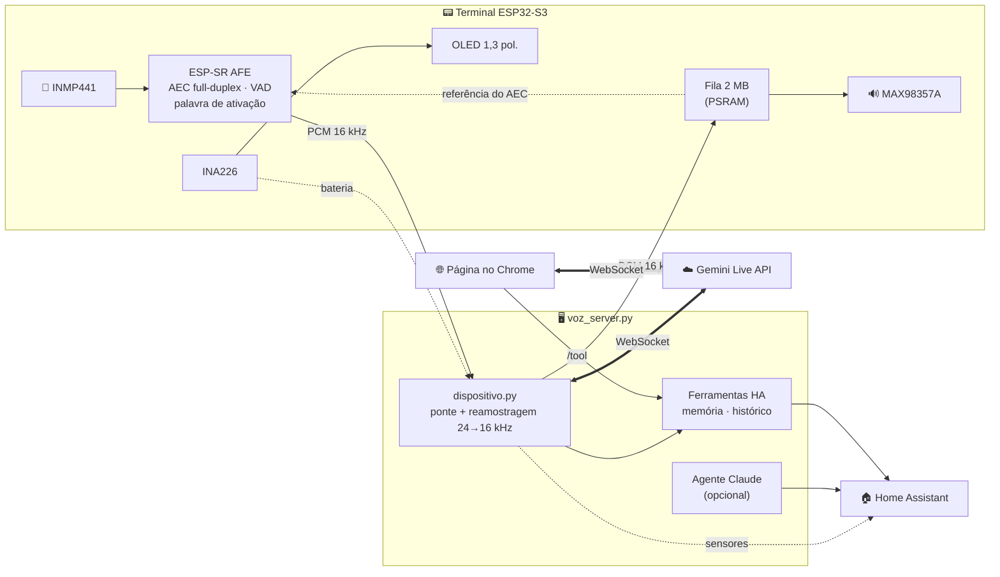
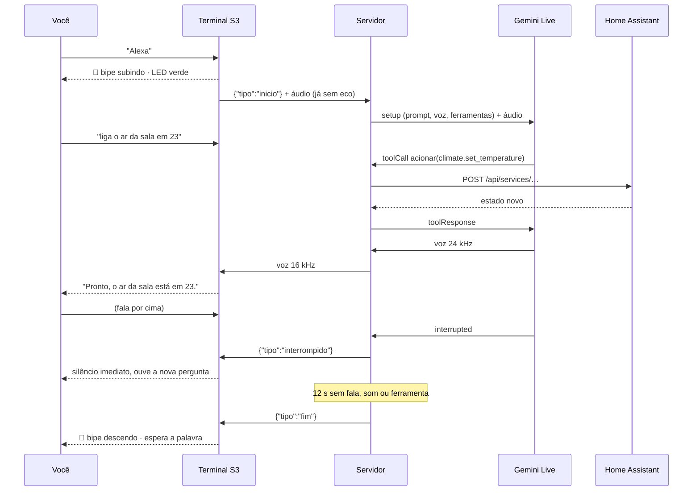

# 🎙️ RLight Live

**Assistente de voz em tempo real para o Home Assistant, com Gemini Live e um terminal físico ESP32-S3 que conversa em full-duplex: você fala por cima e ele para na hora, sem se ouvir.**


Nada de "OK, comando reconhecido". É uma **conversa falada de verdade**, no estilo do ChatGPT voz: ele responde com voz natural, consulta e aciona a casa pelo Home Assistant, lembra de coisas entre conversas e aceita ser interrompido no meio da frase.

Funciona de dois jeitos, com as mesmas ferramentas, memória e histórico:

| | 🖥️ Página no Chrome | 📟 Terminal ESP32-S3 |
|---|---|---|
| Ativação | botão ou "RLight" (ditado do Chrome) | **"Alexa"** no próprio chip (WakeNet do ESP-SR) |
| Eco | AEC do navegador | **AEC full-duplex do ESP-SR** |
| Onde roda | qualquer computador com Chrome | na estante, **na bateria** |
| Extras | transcrição na tela | OLED, bipes, LED, medição de bateria |

---

## ✨ Destaques

- **Full-duplex com interrupção:** o AEC do ESP-SR tira do microfone exatamente as amostras que foram para o alto-falante, então o Gemini não se ouve. Quando você fala por cima, o áudio na fila é descartado em milissegundos.
- **A chave do Gemini nunca sai do servidor:** o S3 só conversa com o seu servidor, por WebSocket com token.
- **Servidor em Python puro:** `voz_server.py` usa só a biblioteca padrão. Até o WebSocket (cliente TLS para o Gemini e servidor para o S3) é um `ws_mini.py` de 150 linhas.
- **Ferramentas de verdade no HA:** busca de entidades por nome ou cômodo, leitura de estado, histórico e ações com lista branca de domínios. Depois de agir, ele relê o estado e diz a verdade se não funcionou.
- **Memória de longo prazo:** "lembra que eu gosto do ar em 23" vira um fato que entra no prompt das próximas conversas.
- **Histórico estruturado:** cada conversa vira um `.jsonl`, com falas, ferramentas, argumentos, resultados e tempos. O `conversas.py` lista, busca e aponta problemas.
- **Agente em segundo plano (opcional):** perguntas que pedem investigação vão para um Claude Code headless, só leitura. Quando termina, o RLight conta o resultado sozinho.
- **Palavra de ativação de uma palavra só:** "Alexa", modelo pronto do ESP-SR treinado com vozes reais, funciona bem com sotaque brasileiro. Há também um notebook do Colab para treinar uma palavra própria ("Ei, Luma").
- **Portátil:** UPS de 2× 18650, INA226 medindo tensão e consumo, sensores no HA, aviso em 20 % e **corte seguro** que põe o terminal para dormir antes de judiar das células.

## 🧭 Arquitetura



### 🔄 Uma conversa, do começo ao fim



## 🧰 Hardware

| Peça | Função |
|---|---|
| **ESP32-S3 N16R8** (16 MB flash, 8 MB PSRAM octal) | cérebro do terminal; a PSRAM é obrigatória para o AFE |
| **INMP441** | microfone I2S |
| **MAX98357A** (I2S, 3 W) + alto-falante 4 Ω 5 W 2" | saída de voz |
| **HW-465A 5V** + 2× INR18650 em paralelo | UPS: carrega pela USB-C e entrega 5 V |
| **INA226** (shunt R100) | tensão das células e consumo *(opcional)* |
| **OLED 1,3"** I2C (SH1106 ou SSD1306) | estado, bateria e transcrição *(opcional)* |
| **Botão de inox com LED** (com trava) | liga/desliga |

> O ESP32-C3 não serve: sem PSRAM, ele não roda a palavra de ativação junto com o cancelamento de eco.

## 🔌 Ligações

Fio de silicone 22 AWG soldado, em 5 cores: 🔴 alimentação · ⚫ terra · 🟡 clock · 🔵 canal · 🟢 dados.
Os vermelhos que **não** são 5 V levam marca: **🔴¹ = 3V3** (o INMP441 queima acima de 3,6 V) e **🔴² = BAT**.

```
UPS OUT+ ─🔴─ INA226 IN+   INA226 IN− ─🔴─ [botão C → NO] ─🔴─ S3 5V ─🔴─ MAX98357A VIN
UPS OUT− ─⚫─ S3 GND                        LED do botão: + no NO, − no GND
INA226 VBS ─🔴²─ + das células (tensão real da bateria, sem passar pelo regulador)
```

| Módulo | 3V3 🔴¹ | GND ⚫ | 🟡 | 🔵 | 🟢 | Outros |
|---|---|---|---|---|---|---|
| **INMP441** → I2S1 | VDD | GND | SCK → **GPIO5** | WS → **GPIO6** | SD → **GPIO7** | L/R em ponte com o GND |
| **MAX98357A** → I2S0 | (VIN 5 V 🔴) | GND | BCLK → **GPIO15** | LRC → **GPIO16** | DIN → **GPIO17** | SD → **GPIO18** (🔵 marcado), GAIN solto |
| **INA226** (0x40) | VCC | GND | SCL → **GPIO9** | — | SDA → **GPIO8** | IN+/IN− na saída 5 V, VBS na bateria |
| **OLED** (0x3C) | VCC | GND | SCL → **GPIO9** | — | SDA → **GPIO8** | mesmo barramento do INA226 |

Pinos evitados: 35–37 (PSRAM octal), 0/3/45/46 (strapping) e 19/20 (USB). O LED RGB da placa (GPIO48) mostra o estado: azul fraco = esperando, verde = conversando, vermelho = sem servidor.

> ⚠️ **Grave e leia o log pela USB-C nativa do S3.** Pela porta do conversor USB-serial ela grava, mas pode ficar presa no modo de gravação (`boot:0x0`).

## ⚡ Energia

Medido no INA226 (corrente das células) com 2× 18650 de ~2450 mAh em paralelo:

| Situação | Consumo | Autonomia |
|---|---|---|
| Esperando a palavra | ~117 mA (~0,38 W na saída 5 V) | ~38 h |
| Conversando | ~250 mA | — |

- **Modo economia** (automático):
  - o amplificador é desligado pelo pino SD fora da fala;
  - a OLED apaga depois de 30 s esperando;
  - o AEC fica desligado esperando a palavra (nada toca) e volta antes do bipe (`RLIGHT_ECONOMIA_CPU`).

  **Testado e tirado:** a frequência dinâmica (`CONFIG_PM_ENABLE`) e o Wi-Fi em *modem sleep* chegaram a ~97 mA esperando, mas o primeiro travava a fala (sem lock a CPU fica em 80 MHz) e o segundo deixava o que chega do servidor a ~4 KB/s (OTA caía, avisos arrastados). Leve e fluido valeu mais que 20 mA.

  Dormir de verdade não dá: ouvir a palavra exige a CPU ligada o tempo todo.
- **Bateria no Home Assistant:** `sensor.luma_<terminal>_bateria` (%), `_bateria_tensao`, `_consumo` (W) e `_corrente_bateria`.
- **Aviso em 20 %:** vai para a central de notificações do HA.
- **Corte seguro:** em 3,55 V (≈ 7 %) o terminal mostra *"carregue"*, desliga o amplificador e o INA226 e dorme 10 min. Ao acordar mede de novo: se já estiver carregando, volta ao normal.

### 🔋 Controle de carga (opcional, mod na UPS)

Com a fonte sempre plugada, o ESP segura a bateria em **~50–60 %**, onde a Li-ion menos envelhece. O carregador do HW-465A é um **"4056D"** (família TP4056), cujo pino 8 (CE) vem soldado no VCC.

- **Mod:** levante o pino 8 da ilha; 100 kΩ do pino 4 ao pino 8; **2N3906** com emissor no pino 8, coletor no GND e base por 10 kΩ ao GPIO (`RLIGHT_CARGA_GPIO`). GPIO em 0 → CE ≈ 0,7 V (para); solto → CE ≈ 3,8 V (carrega).
- **Por que não ligar o GPIO direto:** o 4056 lê 3,3 V como *baixo*, e o CE solto flutua (o multímetro o derrubava a 0,44 V e a carga parava).
- **Detecção da tomada:** divisor 100 kΩ/100 kΩ do "5V+" de entrada da UPS a um GPIO (`RLIGHT_TOMADA_GPIO`).
- **Firmware:** na tomada, libera a carga com a bateria em repouso ≤ 3,75 V e para quando a tensão carregando chega a 3,95 V. O HA ganha `sensor.luma_<terminal>_alimentacao` (`bateria` / `tomada` / `tomada, carregando`), e o terminal fala "Carregando." / "Na bateria." ao plugar ou tirar a fonte (Gemini TTS na voz da conversa, guardado em cache). `POST /carga` (localhost) força a carga para teste.

## 🚀 Começando

### 1. Servidor

```bash
git clone https://github.com/willianrupert/rlight-live && cd rlight-live/servidor
cp config.example.env config.env      # HA_URL, HA_TOKEN, GEMINI_API_KEY, RLIGHT_TERMINAL_TOKEN…
cp prompt.example.md prompt.md        # personalidade e regras da sua casa
python3 voz_server.py
```

- **Página:** abra **http://localhost:8765** no Chrome. O localhost libera o microfone sem HTTPS.
- **Servidor sempre ligado** (num LXC, Raspberry etc.): use o `rlight-live.service` com `RLIGHT_BIND=0.0.0.0`.
- **Segurança:** de fora do localhost só o `/dispositivo` responde, e só com o token. O `/config`, que tem a chave do Gemini, e o `/tool` devolvem 403 para a rede.

### 2. Firmware

```bash
cd firmware
cat > sdkconfig.segredos <<'EOF'
CONFIG_RLIGHT_WIFI_SSID="minha-rede"
CONFIG_RLIGHT_WIFI_SENHA="..."
CONFIG_RLIGHT_SERVIDOR="ws://192.168.1.10:8765/dispositivo"
CONFIG_RLIGHT_TOKEN="o mesmo RLIGHT_TERMINAL_TOKEN do servidor"
EOF
docker run --rm -v "$PWD":/project -w /project espressif/idf:v5.4.2 idf.py build
pip3 install esptool
cd build && python3 -m esptool --chip esp32s3 -p /dev/cu.usbmodem* -b 460800 write-flash "@flash_args"
```

O Docker só compila: não precisa instalar o ESP-IDF. Ajustes finos ficam em `idf.py menuconfig` → **RLight**:
- volume e ganho do mic;
- modo do AEC;
- GPIOs do SD do amplificador e do LED;
- shunt do INA226 e tipo da OLED;
- tensão do corte seguro;
- palavra própria "Ei, Luma" (opcional).

**📦 Depois disso, atualize pelo Wi-Fi (OTA)**, com o terminal fechado e na bateria:

```bash
RLIGHT_SSH=usuario@servidor firmware/ota.sh
```

O script compila e copia o `.bin` para o servidor (`RLIGHT_FIRMWARE`). Depois faz `POST /ota`.
O terminal baixa de `/firmware.bin?token=…`, grava na outra partição de app e reinicia; 1,6 MB
leva ~8 s. O firmware novo só fica se conectar no servidor. Se travar ou passar 3 min sem
servidor, o bootloader volta sozinho ao anterior. Mudar o `partitions.csv`, o bootloader ou os
modelos do ESP-SR ainda exige a USB.

### 3. Testar sem a placa

O `terminal_teste.py` finge ser o S3: manda um WAV 16 kHz em tempo real e grava a resposta.

```bash
say -v Luciana -o /tmp/f1.aiff "Oi, quantos graus faz lá fora?"
afconvert -f WAVE -d LEI16@16000 -c 1 /tmp/f1.aiff /tmp/f1.wav
python3 servidor/terminal_teste.py ws://127.0.0.1:8765 /tmp/f1.wav
python3 servidor/terminal_teste.py ws://127.0.0.1:8765 /tmp/longa.wav /tmp/para.wav --interromper
```

## 🗣️ Palavra de ativação

O firmware acorda com **"Alexa"** (`wn9_alexa`). Entre os modelos prontos do ESP-SR de uma palavra só, é o mais confiável:

- **Três sílabas fortes.** Palavras de 1–2 sílabas disparam à toa ou falham.
- **Treinado com vozes reais.** Os modelos `*_tts` usam voz sintética e erram mais com sotaque brasileiro.
- **Funciona no limiar padrão.** O "Hi ESP" precisava de 0,5.

O Gemini é avisado de que "Alexa" é só o gatilho.

- **Não use o `wn10_alexa`.** Ele pede tanta RAM interna que o `esp_wifi_init` falha com `ESP_ERR_NO_MEM`.
- **Trocar a palavra exige USB.** O modelo fica na partição `model`, que o OTA não grava.
- **Se tiver um Echo em casa,** escolha outra no `menuconfig` → ESP Speech Recognition (por exemplo, `wn9_jarvis_tts`).

### Palavra própria: "Ei, Luma" (opcional)

Para uma palavra que não está entre as prontas, treine um modelo do microWakeWord. Ele tende a ser menos confiável que a "Alexa", porque o treino é só com voz sintética.

1. Abra [`palavra_luma/treinar_ei_luma.ipynb`](palavra_luma/treinar_ei_luma.ipynb) no Colab (GPU T4, ~1–2 h).
   - **Positivas:** *"hey luma"* em ~900 vozes do Piper LibriTTS-R, que soa quase igual; vozes Piper pt-BR; Edge TTS com velocidade e tom variando.
   - **Negativas parecidas:** "Ei, Luna", "Ei, Lula", "uma", "pluma"… além das negativas gerais do microWakeWord.
2. Escolha o limiar com < 0,5 falso positivo por hora (`RLIGHT_LUMA_LIMIAR`).
3. Copie o `ei_luma.tflite` para `firmware/main/palavra/`, ligue `RLIGHT_PALAVRA_LUMA` e recompile.

Com o "Ei, Luma" a WakeNet é desligada: o microWakeWord ocupa o lugar dela, roda na saída do AFE (já sem eco) e mede o próprio custo de CPU no log. O `luma.cc` segue o componente `micro_wake_word` do ESPHome: mesmo frontend, mesmas operações e mesma escala de features.

Quer outra palavra? Troque as frases no [`gerar_notebook.py`](palavra_luma/gerar_notebook.py).

## 🔧 Ferramentas do assistente

| Ferramenta | O que faz |
|---|---|
| `buscar_entidades` | busca por nome, cômodo ou id (sem acento, ranqueada) |
| `ler_estado` | estado detalhado: temperatura, modos, brilho, quando mudou |
| `acionar` | chama um serviço do HA (lista branca de domínios) e relê o estado |
| `historico` | histórico amostrado das últimas N horas |
| `lembrar` / `esquecer` | memória de longo prazo (`memoria.json`) |
| `pedir_ao_agente` | *(opcional)* investigação demorada com o Claude Code, só leitura |

## 📡 Protocolo do terminal

WebSocket `ws://<servidor>:8765/dispositivo?token=…`. Texto = JSON, binário = PCM16 mono 16 kHz.

| Direção | Mensagem | Quando |
|---|---|---|
| S3 → servidor | `{"tipo":"ola","id":"sala"}` | ao conectar |
| S3 → servidor | `{"tipo":"inicio","origem":"palavra"}` + binário | palavra detectada |
| S3 → servidor | `{"tipo":"vad","fala":true}` | mantém a sessão viva enquanto você fala |
| S3 → servidor | `{"tipo":"bateria","v":3.95,"ma":184,"pct":72}` | a cada 10 s |
| servidor → S3 | binário | voz do RLight, já em 16 kHz |
| servidor → S3 | `{"tipo":"interrompido"}` | você falou por cima: esvaziar a fila |
| servidor → S3 | `{"tipo":"texto","quem":"r","t":"…"}` | transcrição para a OLED |
| servidor → S3 | `{"tipo":"sessao","origem":"agente"}` | resultado do agente: abrir sessão sem palavra |
| servidor → S3 | `{"tipo":"fim"}` | inatividade: voltar a esperar a palavra |

## 📁 Estrutura

```
servidor/       voz_server.py · dispositivo.py (ponte do S3) · ws_mini.py · index.html
                conversas.py (histórico) · agente_ler.py · terminal_teste.py
firmware/       ESP-IDF: main.c (áudio, AFE, WebSocket) · tela.c (OLED + INA226)
                luma.cc (microWakeWord) · Kconfig.projbuild (menuconfig → RLight)
palavra_luma/   notebook do Colab para treinar uma palavra própria ("Ei, Luma")
```

## 🗺️ Status

- [x] Página no Chrome com palavra de ativação, interrupção, memória, histórico e agente
- [x] Ponte do terminal no servidor, testada ponta a ponta com o terminal falso (ferramentas, interrupção, agente)
- [x] Firmware: compila no ESP-IDF 5.4 e roda na placa (AFE com AEC full-duplex, Wi-Fi, WebSocket)
- [x] Bateria no HA, aviso em 20 % e corte seguro
- [x] Montado e testado de verdade: palavra, perguntas, controle de luz, agente e conversa longa sem queda
- [x] Palavra de ativação "Alexa" (uma palavra só, confiável com sotaque BR)
- [x] Gravação pelo Wi-Fi (OTA) com volta automática
- [x] Modo economia medido (~97 mA esperando, ~44 h) e interrupção sem portão de eco

### 🔧 Lições do primeiro teste com o hardware montado

| Sintoma | Causa | Ajuste |
|---|---|---|
| A palavra não disparava | INMP441 entrega voz baixa, e um ronco < 100 Hz (ripple do boost do UPS) era maior que ela | Passa-alta de 100 Hz antes do ganho, ganho ×8 e limiar do WakeNet 0,5 |
| WebSocket caía a cada ~15 s | Wi-Fi fraco + buffers TCP de 5,7 KB; o `esp_websocket_client` derruba a conexão em qualquer escrita que estoure o prazo | TCP/Wi-Fi com 32 KB e envio numa tarefa separada, com fila de 2 s na PSRAM |
| Ela se respondia em loop | Eco: o alto-falante satura o mic e o AEC não cancela tudo | Volume 55 % + portão de eco: enquanto fala, só sobe áudio se o pós-AEC passar de −22 dBFS por 100 ms. Depois o portão saiu (ver abaixo) |
| Som de lata, depois chiado | Alto-falante pequeno; reforçar grave saturava | EQ só de corte (`RLIGHT_EQ`): menos grave < 150 Hz e −4 dB acima de 3,5 kHz |
| Sessão do Gemini caía (`1007`) | Provável: pedaço de áudio com meia amostra | Só blocos inteiros no firmware, realinhamento no servidor e sessão nova se a retomada falhar |

A RAM interna do S3 fica com ~23 KB livres: coisa nova vai para a PSRAM.

**Interromper sem gritar:** com o portão de eco, cortar a resposta exigia falar muito alto, e a
conversa parecia a de uma Alexa comum. Agora o servidor manda `{"tipo":"config","portao":N}`
quando o terminal conecta (`RLIGHT_PORTAO_DBFS`, padrão **−100 = desligado**), e quem separa eco
de voz é o VAD do Gemini, com `startOfSpeechSensitivity: START_SENSITIVITY_LOW`
(`RLIGHT_VAD_INICIO`). No primeiro teste foram 9 min de conversa sem loop. Se o loop voltar,
suba o portão (ex.: −30) no servidor, sem regravar o firmware.

O servidor mede o atraso de cada interrupção (`✋ interrompido (X s depois do VAD do S3)`):
2–5 s com `LOW`. Com `START_SENSITIVITY_HIGH` caiu para 0,1–0,3 s, mas sem portão o eco virou
"fala" e ela se interrompia em loop, repetindo a mesma frase. Interromper rápido depende de o eco
chegar mais fraco no mic (isolar mic e alto-falante, alinhar o atraso do AEC).

**Mais armadilhas do firmware:**
- **Conversa caía no meio:** a leitura da bateria ia direto no WebSocket com prazo de 200 ms; ao estourar, o `esp_websocket_client` derruba a conexão. Tudo passa pela fila da tarefa de envio.
- **"Letra travada" e ruído alto:** o WebSocket entrega pedaços de tamanho ímpar; a reprodução só toca amostras inteiras.
- **Fala antiga depois de interromper:** depois do `interrompido`, o S3 descarta por 500 ms a voz que ainda vinha no TCP.
- **Sem servidor:** depois de 2 min sem conexão, o S3 reinicia sozinho. O motivo do último reinício vai junto da versão no `ola` (9 = queda de tensão).

**Outras correções do servidor:**
- **Busca de luz:** inclui os relés `switch.luz_*` e deixa LEDs de botão por último.
- **Horários do HA:** passam para o fuso local (defina `TZ` no serviço), e o agente recebe a hora atual.

## 📜 Licença

[MIT](LICENSE). Os dados de treino da palavra de ativação baixados pelo notebook têm licenças próprias, e os modelos treinados com eles são para uso pessoal, não comercial.
